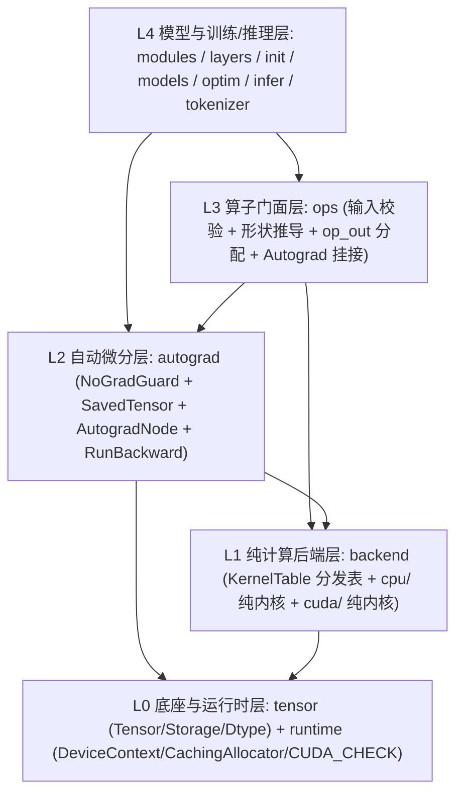

# mini_infer 训推一体框架架构设计

`mini_infer` 的目标是从零实现一个可同时用于**模型训练（Eager Autograd）**与**大模型推理（Prefill / Decode + KV Cache）**的 C++17 框架。本文说明重构后的五层模块划分、核心分发机制、自动微分组织以及推理扩展边界。

对应架构图见 [框架架构图.drawio](框架架构图.drawio)。

---

## 一、总体分层与单向依赖

框架自底向上分为五层，依赖只允许单向向下，禁止跨层反向引用：



| 分层 | 目录 | 核心职责 | 设计借鉴 |
| --- | --- | --- | --- |
| **L0 底座与运行时** | `src/tensor/`、`src/runtime/` | 布局元数据、存储所有权、CUDA 显存池、`DeviceContext`（流与同步） | PyTorch `c10` + OneFlow `EP` + `ggml` Allocator |
| **L1 纯计算后端** | `src/backend/` | 按 `(OpSlot, Device)` 分发并执行前向/反向纯内核，统一 `Dtype` 调度 | PyTorch `DispatchStub` + `ggml` 轻量注册 |
| **L2 自动微分** | `src/autograd/` | 建图开关、输入梯度剪枝、`SavedTensor` 版本检查、DFS 反向引擎 | PyTorch `Autograd` + `SavedVariable` |
| **L3 算子门面** | `src/ops/` | 参数检查、`*_out` / `op` 分离、通过 `KernelTable` 调后端、挂载纯设备无关的 `AutogradNode` | PyTorch `ATen` + OneFlow `Functional` |
| **L4 训练与推理** | `src/modules/`、`src/layers/`、`src/models/`、`src/optim/`、`src/infer/` | 权重容器、Transformer 层、GPT 模型、优化器、KV Cache 与增量采样 | vLLM `ForwardContext` / `KVCache` |

---

## 二、核心机制设计

### 1. Device 分发：显式注册的强类型 `KernelTable`

过去每个算子各自写 `if (device == kCPU) ... #ifdef ENABLE_CUDA else if (device == kCUDA)`，且各自声明 `kernels.h` 或直接在 `.cpp` 内前向声明 `CUDA` 函数，导致分发、异常类型与参数约定四分五裂。

新方案使用 **静态强类型分发槽（`KernelSlot<FnPtr>`）+ 显式一次性注册（`GetKernelTable()`）**：

```cpp
// src/backend/dispatch.h
template <typename FnPtr>
struct KernelSlot {
    FnPtr cpu = nullptr;
    FnPtr cuda = nullptr;

    void register_fn(Device device, FnPtr fn);

    template <typename... Args>
    void call(Device device, const char* op_name, Args&&... args) const;
};
```

- **为什么用显式注册函数而不是全局静态自注册？**
  [CMakeLists.txt](../../CMakeLists.txt) 将 `mini_infer` 编译为 `STATIC` 库。静态库链接时，若仅靠全局静态对象自注册而没有外部符号引用，链接器会整文件丢弃 `.o`/`.obj`。由 `GetKernelTable()` 在 `static` 初始化块中显式调用 `RegisterCPUKernels(table)` 与受 `#ifdef ENABLE_CUDA` 保护的 `RegisterCUDAKernels(table)`，可保证在 Windows MSVC 与 Linux GCC 下 100% 稳定链接，并把条件编译收敛到**唯一一处**。
- **统一后端契约**：所有注册内核第一个参数均为 `DeviceContext& ctx`，其后为输入/输出 `Tensor`（或原始布局），**后端代码严禁创建 `AutogradNode` 或修改计算图状态**。

### 2. Dtype 分发：`dtype_dispatch.h`

在 `src/backend/common/dtype_dispatch.h` 中使用 C++17 `TypeTag<T>` 模板函数替代各算子重复的 8 路 `switch (dtype)`：

- `DispatchAllDtypes(dtype, fn)`：覆盖 `Float32`、`Float16`、`BFloat16`、`Int8`、`UInt8`、`Int16`、`Int32`、`Int64`。
- `DispatchFloatingDtypes(dtype, fn)`：覆盖 `Float32`、`Float16`、`BFloat16`。
- `DispatchIntegralDtypes(dtype, fn)`：覆盖 5 种整数类型。

### 3. 反向内核“算子化”与 `Autograd` 解耦

旧架构中，`SigmoidNode`、`SiluNode`、`RsqrtNode`、`ExtremaNode`、`RMSNormNode`、`CausalAttentionNode`、`CrossEntropyNode`、`EmbeddingNode` 都在 `AutogradNode::backward()` 内亲自做 CPU/CUDA 设备分发。

重构后，反向节点统一通过 `SavedTensor` 取回张量，再选择反向实现：

1. **专用前后向放在对应设备的同一个后端文件**：例如 SiLU 和交叉熵。CPU、CUDA 各自注册，`ops/` 只通过 `KernelTable` 调用，不为设备开旁路。
2. **在后端复用已有算子**：Softmax 和 CPU 交叉熵通过已有的 Tensor 操作和 `*_out` 组合公式，不重复实现广播或类型转换。调用层在分发前用 `NogradNode` 关闭建图；交叉熵反向直接复用 `SoftmaxCPU`。
3. **统一 `rms_norm` 计算图拓扑**：修复过去 FP32 走复合算子拆图而 FP16/BF16 走 `RMSNormNode` 的分裂行为。三种浮点类型统一挂载 `RMSNormNode`，FP32 的组合计算封装为 `RMSNormCPU`/`RMSNormCUDA` 内部实现。
4. **按需建图与剪枝（`ShouldRecordGrad`）**：
   - 仅当 `EnableGrad() && CheckGradDtype(out_dtype) && AnyNeedsGrad(inputs)` 成立时才创建 `AutogradNode`（任一输入 `requires_grad() || grad_node() != nullptr`）。
   - `AutogradNode` 通过 `record_inputs(...)` 记下 `input_needs_grad_` 掩码，允许只计算需要的输入梯度；反向引擎对无需梯度的输入跳过 `accumulate_grad` 和临时梯度表插入。
   - 提供 `NoGradGuard` 命名，并保留 `using NogradNode = NoGradGuard;` 兼容现有代码。

### 4. `op_out` 与 `op` 分离（兼顾训练建图与推理复用）

对于有独立输出的原语算子，区分两层内部/公开路径：

- **执行层（`*_out`）**：检查参数、确认或写入已分配的 `Tensor& out`，通过 `KernelTable` 派发到底层计算。推理循环、优化器原地更新与复用缓冲区路径可直接调用它，不产生多余分配。
- **算子层（`op`）**：推导输出形状和类型、分配新 `Tensor`、调用 `*_out`，并在满足 `ShouldRecordGrad` 时挂上 `AutogradNode`。

---

## 三、训推一体与推理扩展架构

为了与后续的连续批处理、Paged Attention、算子融合与量化平滑衔接，本次重构落实了推理所需的 4 个基础模块：

1. **CUDA 显存池（`CUDACachingAllocator`）**
   位于 `src/runtime/memory.cpp`。替代每次创建/释放临时 Tensor 时直连 `cudaMalloc` / `cudaFree` 的同步开销；按 256 字节对齐、分桶复用已释放显存块，并提供 `EmptyCUDACache()` 显式回收。
2. **`DeviceContext` 抽象**
   位于 `src/runtime/device_context.h`。所有算子后端都接收 `DeviceContext&`，目前承载设备索引与默认流访问，后续可直接接入多 CUDA Stream、cuBLAS 句柄与临时 Scratchpad。
3. **带位置偏移的 RoPE 与 `KVCache`**
   - [rope.h](../../include/mini_infer/ops/position_embedding.h) 新增支持 `pos_offset`（默认 `0`）：训练和全序列前向保持不变，增量 decode 时从 `past_len` 计算当前 token 的旋转角。
   - `include/mini_infer/infer/` 新增 `KVCache` 与 `AttentionMetadata`：按模型层数保存预分配的连续 Key/Value 缓冲 `[max_seq_len, channels]` 与 `current_length`。
   - `backend/` 新增 `cached_attention` CPU/CUDA 内核，在统一 `SimpleDecoderLayer` 和 `GPT` 模型上同时支持：
     - **训练前向**：`model.forward(tokens)`，构建完整 Autograd 计算图。
     - **KV Cache 推理前向（Prefill + Decode）**：`model.forward(tokens, kv_cache, attn_meta)`，在 `NoGradGuard` 下复用完全相同的权重与算子，只为新增 token 计算 Q/K/V、写入 `KVCache` 并执行增量注意力。
4. **`Sampler` 抽离**
   将原先耦合在示例头文件的温度/采样逻辑整理为 `include/mini_infer/infer/sampler.h` 与 `src/infer/sampler.cpp`，供 `chat_gpt` 及后续服务化复用。

---

## 四、重构后源码目录一览

```text
src/
├── tensor/                    # Tensor 句柄元数据、布局视图、校验与打印
├── runtime/                   # Memory/CUDACachingAllocator、DeviceContext、cuda_check.h
├── autograd/                  # NoGradGuard、SavedTensor、DFS 拓扑排序与梯度累加
├── ops/                       # 设备无关的算子入口 + AutogradNode
│   ├── common/                # 输入校验、形状推导、广播与注意力尺寸检查
│   ├── nodes.h                # 供测试检查的基础 Node 声明 (SumNode, CloneNode, ToDeviceNode, ToDtypeNode)
│   ├── elementwise.cpp        # + / - / * / / / neg / sqrt / rsqrt / exp / log
│   ├── activation.cpp         # sigmoid / silu / softmax
│   ├── matmul.cpp             # matmul
│   ├── norm.cpp               # rms_norm
│   ├── reduction.cpp          # sum / mean / max / min
│   ├── layout.cpp             # [], narrow, transpose, permute, reshape, broadcast, squeeze, unsqueeze
│   ├── tensor_ops.cpp         # copy_, clone, to(Device/Dtype), fill_, zero_, full
│   ├── embedding.cpp          # embedding
│   ├── rope.cpp               # rope (支持 pos_offset)
│   ├── attention.cpp          # causal_attention / cached_attention
│   └── loss_fn.cpp            # cross_entropy
├── backend/                   # 纯计算内核（无 Autograd 依赖）
│   ├── dispatch.h / .cpp      # KernelSlot 与 KernelTable
│   ├── common/                # dtype_dispatch.h, cpu_iteration.h, cuda_layout.*, cuda_index.cuh, cuda_unary.cuh
│   ├── cpu/                   # register.cpp + 各域纯 CPU 前/反向内核
│   └── cuda/                  # register.cu + 各域纯 CUDA 前/反向内核
├── modules/                   # Module, Linear, RMSNorm
├── layers/                    # Embedding, SimpleDecoderLayer
├── init/                      # 权重初始化
├── models/                    # GPT, GPTCheckpoint
├── infer/                     # KVCache, Sampler
├── optim/                     # Optimizer, SGD, Adam
├── tokenizer/                 # Tokenizer, BPETokenizer
└── utils/                     # Logger
```

## 五、TODO

- [ ] 补充显存池复用、释放和异常路径的边界验证。
- [ ] 继续整理其余 dtype `switch`，并让昂贵的反向计算按输入梯度掩码跳过无需求部分。
- [ ] 按实际需要扩展其他算子的 `*_out`，补充 RoPE 非零位置偏移用例。
- [ ] 整理 `ops/` 目录和各模块说明，使目录表、设计图与源码一致。
- [ ] 后续实现 KV Cache、增量注意力、GPT Prefill/Decode 与 Sampler。
